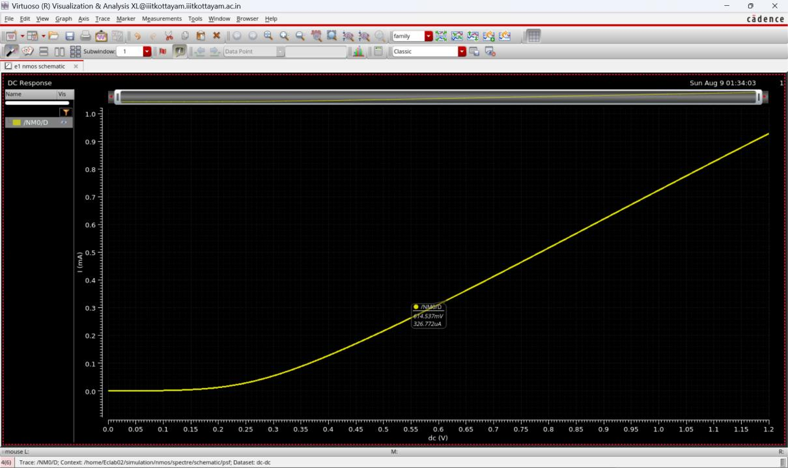
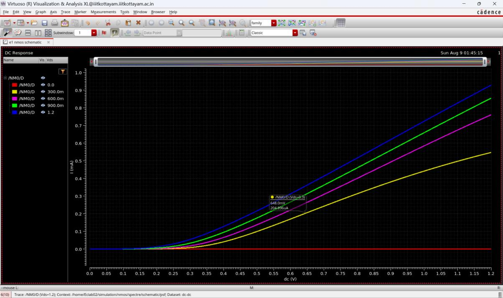
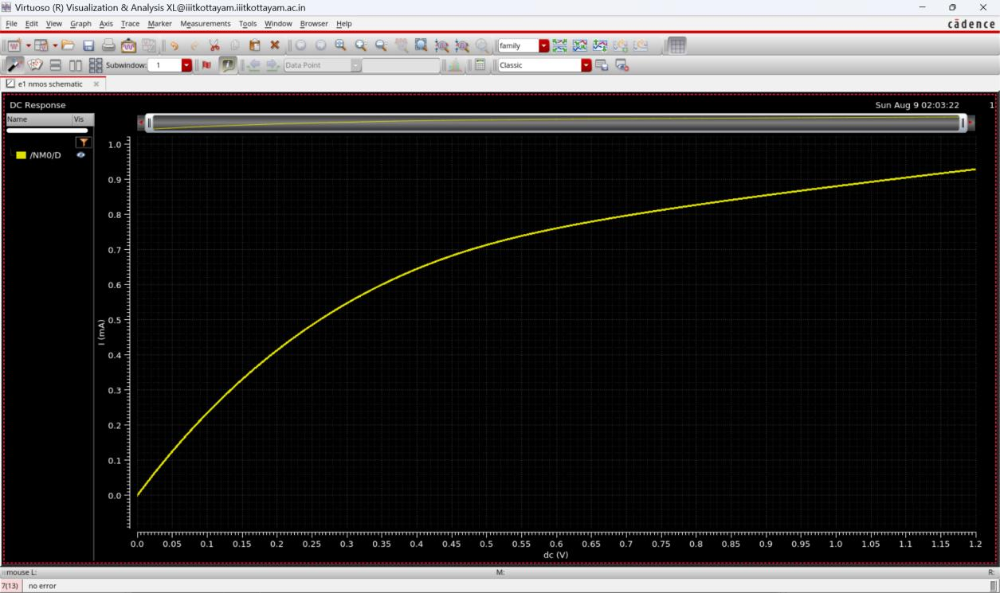
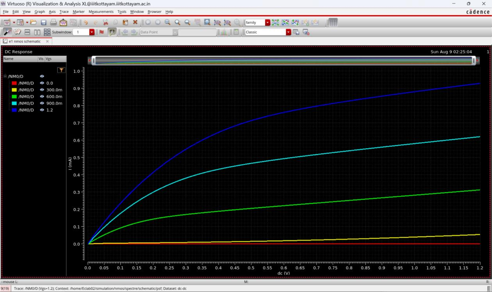
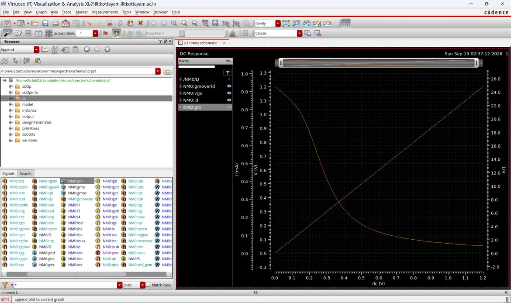
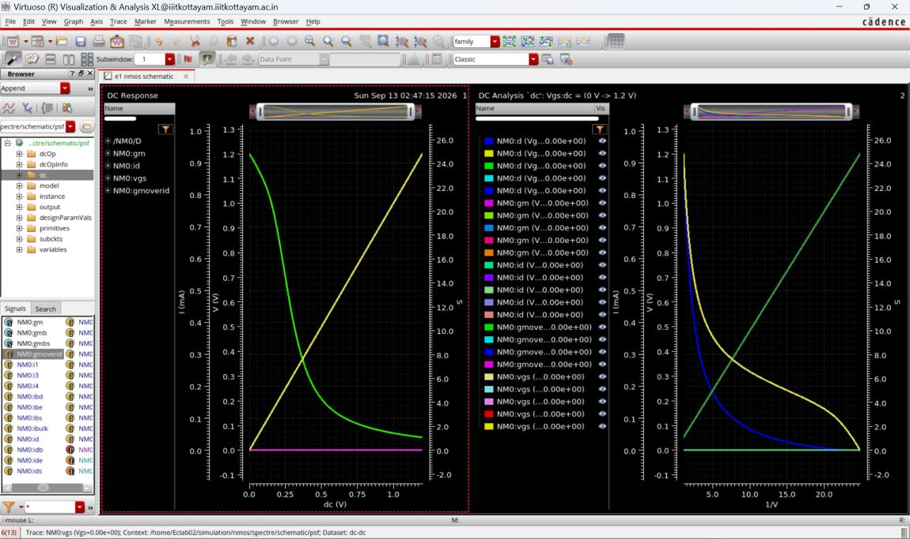

# Experiment 01 – MOSFET (NMOS) Characterization

[⬅ Back to all experiments](../README.md) · [📄 Full Report (PDF)](./Report.pdf)

**Tools:** Cadence Virtuoso (Schematic Editor, ADE L, Parametric Analysis), Spectre, gpdk090 `nmos1v`

## Contents
1. [Aim](#1-aim)
2. [Design Specifications](#2-design-specifications)
3. [Circuit Description](#3-circuit-description)
4. [Simulation Procedure](#4-simulation-procedure)
5. [Results](#5-results)
6. [Observations](#6-observations)
7. [Conclusion](#7-conclusion)
8. [Folder Structure](#8-folder-structure)

---

## 1. Aim
- To obtain and plot the **transfer characteristics** (ID vs VGS) and **drain characteristics** (ID vs VDS) of an NMOS transistor using Cadence Virtuoso ADE-L.
- To use the **gm/ID methodology** to size the device for a target bias current of **ID = 1 mA** at **gm/ID = 8** (moderate inversion).

## 2. Design Specifications
| Parameter | Value |
|---|---|
| Technology | gpdk090 (90 nm CMOS) |
| Device | `nmos1v` |
| Initial size (characterization) | W = 1 µm, L = 100 nm |
| Supply / sweep range | VGS, VDS: 0 to 1.2 V |
| Target drain current | ID = 1 mA |
| Target gm/ID | 8 |

## 3. Circuit Description
A single NMOS transistor is biased by two DC voltage sources: **VGS** is connected to the gate and **VDS** to the drain. The source and bulk are tied to ground. Either source is swept while the other is held fixed.


| Test | Schematic |
|---|---|
| Transfer characteristics (sweep VGS, fixed VDS) | [View](./Schematic/01_transfer_characteristics_schematic.png) |
| ID vs VGS for several VDS | [View](./Schematic/02_id_vgs_parametric_schematic.png) |
| Drain characteristics (sweep VDS, fixed VGS) | [View](./Schematic/03_drain_characteristics_schematic.png) |
| ID vs VDS for several VGS | [View](./Schematic/04_id_vds_parametric_schematic.png) |
| Final sized design (W = 10.6 µm, VGS = 359.2 mV) | [View](./Schematic/05_verification_schematic_W10.6u_Vgs359.2m.png) |

## 4. Simulation Procedure
**A. DC characterization**
1. Draw the NMOS test circuit in the schematic editor.
2. Run a DC sweep of VGS (0 to 1.2 V) with VDS fixed, and plot **ID vs VGS**. ([ADE setup](./Simulation/01_ade_transfer_characteristics.png))
3. Use **Tools → Parametric Analysis** to sweep VDS and obtain a family of ID vs VGS curves. ([Parametric setup](./Simulation/03_parametric_analysis_vds_sweep.png))
4. Repeat with VDS as the sweep variable and VGS as the parameter to get **ID vs VDS**. ([ADE setup](./Simulation/04_ade_drain_characteristics.png))
5. Print the DC operating point (**Results → Print → DC Operating Point**) and note the region of operation.

**B. gm/ID methodology**
1. Create `saveop.scs` containing `save NM0:all` ([terminal](./Simulation/05_terminal_gedit_saveop.png), [file](./Simulation/06_saveop_scs_file.png)).
2. In ADE-L, add it under **Setup → Simulation Files** ([setup](./Simulation/07_simulation_files_setup.png)).
3. Run DC analysis with VGS as the sweep variable. In the Results Browser, plot **id, gm and gm/id vs VGS**.
4. Plot **ID/W vs gm/ID** and **VGS vs gm/ID**.
5. Using the calculator, find the values at gm/ID = 8:
   ```
   cross(getData("/NM0:gmoverid" ?result "dc") 8 1 "either")
   ```
6. Compute the width: `W = ID(required) / (ID/W)`.
7. Update W and VGS in the schematic and re-run the DC operating point to verify ID.

## 5. Results

### 5.1 Transfer characteristics (ID vs VGS)
| Fixed VDS | Family of curves (VDS = 0, 0.3, 0.6, 0.9, 1.2 V) |
|---|---|
|  |  |

### 5.2 Drain characteristics (ID vs VDS)
| Fixed VGS | Family of curves (VGS = 0, 0.3, 0.6, 0.9, 1.2 V) |
|---|---|
|  |  |

### 5.3 DC operating point
- [Operating point: region of operation](./DC_Operating_Point/01_op_point_region_of_operation.png)
- [Operating point after sizing (verification)](./DC_Operating_Point/02_op_point_verification_id.png)

### 5.4 gm/ID plots



### 5.5 Design calculation
Calculator expression and results: [expression](./Design_Calculations/01_calculator_cross_expression.png) · [ID/W table](./Design_Calculations/02_calculator_id_per_w_table.png) · [VGS table](./Design_Calculations/03_calculator_vgs_at_gmid8_table.png)

| Quantity | Value |
|---|---|
| ID/W at gm/ID = 8 | ≈ 95.1 µA/µm |
| VGS at gm/ID = 8 | ≈ 359.2 mV |
| Width | W = 1 mA / 95.1 µA/µm ≈ **10.6 µm** |

### 5.6 Verification
With W = 10.6 µm, VGS = 359.2 mV, VDS = 1.2 V:

| Target ID | Simulated ID | Error |
|---|---|---|
| 1 mA | 981.7 µA | ≈ 1.8 % |

## 6. Observations
- ID is almost zero below the threshold region and rises with VGS, so the device behaves as a voltage-controlled current source.
- In the ID vs VDS curves, ID rises in the triode region and then flattens in saturation. The curve keeps a small slope, which is channel-length modulation.
- A larger VGS gives a higher ID curve in the drain characteristics.
- At VGS = 1 V and VDS = 1.2 V the operating point reports the device in **saturation** (region = 2, VDS = 1.2 V > VDSAT ≈ 421.7 mV).
- gm/ID is highest at low VGS (weak inversion) and falls as VGS increases (strong inversion). Choosing gm/ID = 8 fixes a moderate-inversion bias point that balances speed and power.
- The simulated ID (981.7 µA) is slightly below 1 mA. The small difference comes from rounding W and VGS in the design.

## 7. Conclusion
The transfer and drain characteristics of the `nmos1v` device were obtained, and the region of operation was verified from the DC operating point. Using the gm/ID methodology, the device was sized to **W = 10.6 µm** for **ID = 1 mA at gm/ID = 8**, and the simulated current of **981.7 µA** confirms the design within about 2 %.

## 8. Folder Structure
```
Experiment01_NMOS_Characterization
├── README.md
├── Schematic/
├── Simulation/
├── DC_Operating_Point/
├── IV_Characteristics/
├── gm_gmoverID_Plots/
├── Design_Calculations/
└── Report.pdf
```
