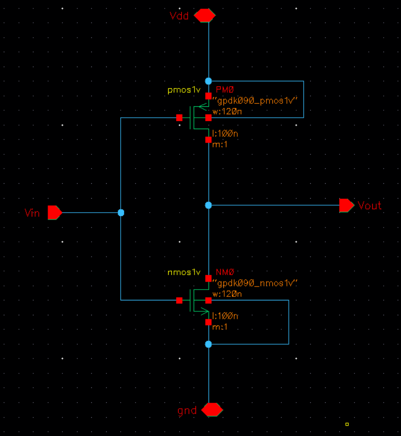
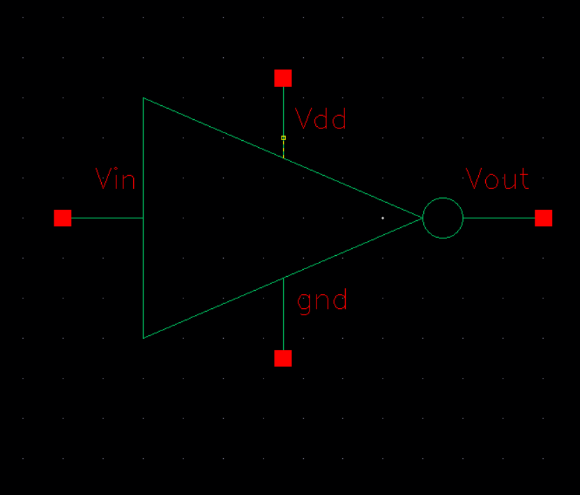
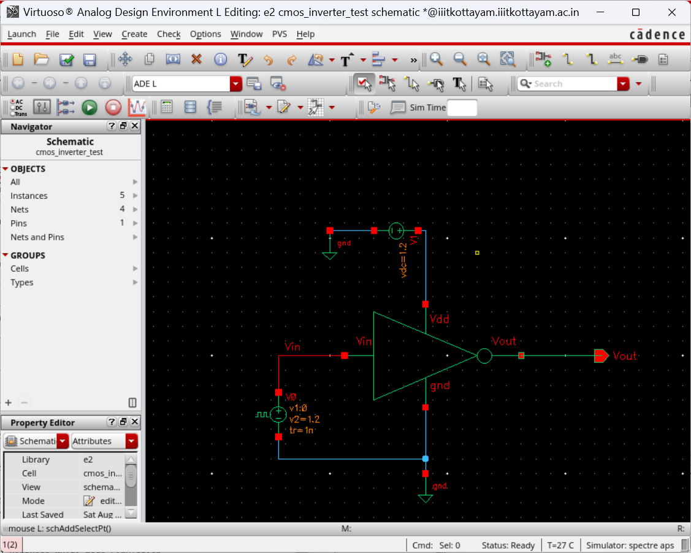
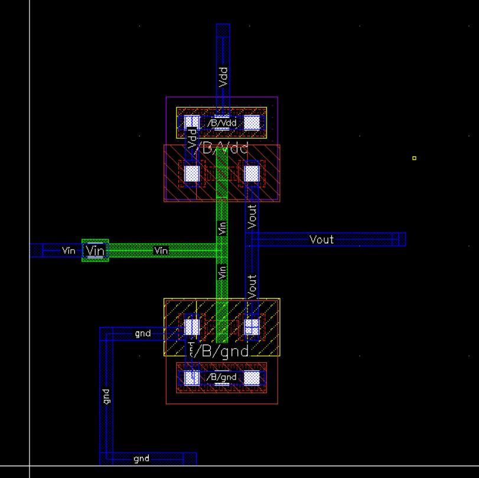
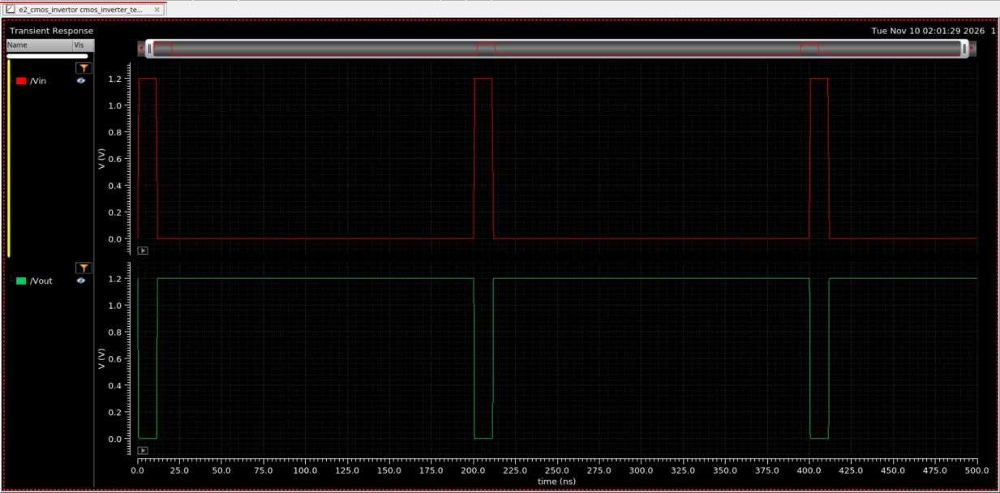
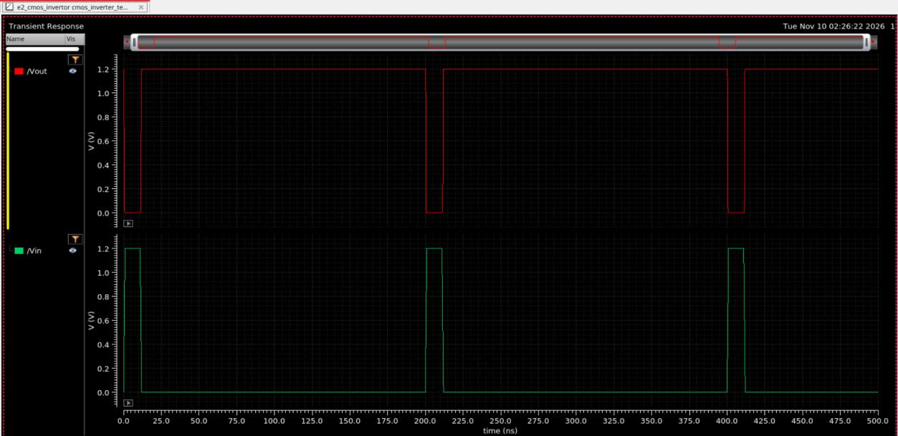

# Experiment 02 – CMOS Inverter: Schematic to Post-Layout

[⬅ Back to all experiments](../README.md) · [📄 Full Report (PDF)](./Report.pdf)

**Tools:** Cadence Virtuoso (ADE L, Spectre, Layout XL), Assura (DRC, LVS), Quantus QRC, gpdk090 (90 nm CMOS)

## Contents
1. [Aim](#1-aim)
2. [Design Specifications](#2-design-specifications)
3. [Circuit Description](#3-circuit-description)
4. [Simulation Procedure](#4-simulation-procedure)
5. [Results](#5-results)
6. [Observations](#6-observations)
7. [Conclusion](#7-conclusion)
8. [Folder Structure](#8-folder-structure)

---

## 1. Aim
- To learn **full-custom layout design** principles in Cadence Virtuoso.
- To gain hands-on exposure to the complete IC design flow: schematic entry, symbol creation, pre-layout simulation, layout, **DRC**, **LVS**, parasitic extraction (**QRC**) and post-layout verification.
- To compare the propagation delay before and after layout.

## 2. Design Specifications
| Parameter | Value |
|---|---|
| Technology | gpdk090 (90 nm CMOS) |
| Devices | `nmos1v`, `pmos1v` |
| Wn / Wp | 120 nm / 120 nm |
| L | 100 nm |
| VDD | 1.2 V |
| Transient analysis | 0 to 500 ns, moderate accuracy |
| Input stimulus | Pulse source on Vin (V1 = 0, V2 = 1.2 V, tr = 1 ns) |

## 3. Circuit Description
The CMOS inverter has a PMOS pull-up connected to VDD and an NMOS pull-down connected to ground. Both gates are tied to **Vin**, and both drains are tied to **Vout**. Pins (Vin, Vout, Vdd, gnd) are used instead of global nets.

| View | Preview |
|---|---|
| Schematic |  |
| Symbol |  |
| Testbench |  |

## 4. Simulation Procedure
1. **Schematic:** draw the inverter with `nmos1v` and `pmos1v`, add pins, then check and save.
2. **Symbol:** create it via *Create → Cellview → From Cellview*.
3. **Testbench:** instantiate the symbol, add the pulse source on Vin and the supply.
4. **Pre-layout simulation:** run a transient analysis (0 to 500 ns) and measure the delay with the calculator `delay()` function. ([ADE setup](./Prelayout_Simulation/01_ade_setup.png))
5. **Layout:** *Launch → Layout XL*, then *Connectivity → Generate → All from Source*. Place the devices and route Metal-to-Metal, poly-to-poly and Metal-to-poly (via), matching the schematic.
6. **DRC:** run Assura DRC and fix any errors.
7. **LVS:** run Assura LVS to confirm the layout matches the schematic.
8. **QRC:** run Quantus to extract parasitic R and C and generate the `av_extracted` view.
9. **Post-layout simulation:** update the testbench configuration to use the `av_extracted` view, re-run the transient analysis and measure the delay.

## 5. Results

### 5.1 Layout


### 5.2 Verification
| Check | Result | Screenshot |
|---|---|---|
| DRC | **No DRC errors found** | [View](./DRC/01_drc_no_errors.png) |
| LVS | **Schematic and Layout Match** (0 net, device, pin and parameter mismatches) | [Summary](./LVS/01_lvs_run_summary.png) · [Debug](./LVS/02_lvs_debug_schematic_layout_match.png) |
| Quantus (QRC) | Completed successfully, view `av_extracted` | [View](./Extracted_View/01_quantus_qrc_av_extracted.png) |

### 5.3 Transient waveforms
| Pre-layout | Post-layout |
|---|---|
|  |  |

ADE L windows: [Pre-layout delay](./Prelayout_Simulation/02_ade_delay_98.67ps.png) · [Post-layout delay](./Postlayout_Simulation/01_ade_extracted_delay_88.84ps.png)

### 5.4 Delay comparison
| Simulation | Propagation delay |
|---|---|
| Pre-layout | 98.6745 ps |
| Post-layout | 88.8373 ps |

## 6. Observations
- Vout is the logical inversion of Vin in both the pre-layout and post-layout simulations.
- The layout passed DRC with no errors, and LVS reported no mismatches, so the layout is consistent with the schematic.
- The propagation delay changed from **98.67 ps (pre-layout) to 88.84 ps (post-layout)**, a decrease of about 10 %.
- Parasitics normally increase delay. The report attributes the decrease to the extracted geometry giving lower effective junction capacitance than the pre-layout estimate, which outweighs the added interconnect parasitics.
- Source and drain are semiconductor regions connected to metal through contacts, the gate is polysilicon, and VDD, GND and Vout are routed in metal.

## 7. Conclusion
The CMOS inverter was taken through the complete flow: schematic, symbol, layout, DRC, LVS, parasitic extraction and simulation at both schematic and extracted levels. The layout is DRC-clean and LVS-matched. The post-layout delay (**88.84 ps**) was slightly lower than the pre-layout delay (**98.67 ps**), showing the effect of the extracted layout parasitics on the switching behaviour.

## 8. Folder Structure
```
Experiment02_CMOS_Inverter_Layout
├── README.md
├── Schematic/
├── Symbol/
├── Layout/
├── DRC/
├── LVS/
├── Extracted_View/
├── Testbench/
├── Prelayout_Simulation/
├── Postlayout_Simulation/
├── Waveforms/
└── Report.pdf
```

