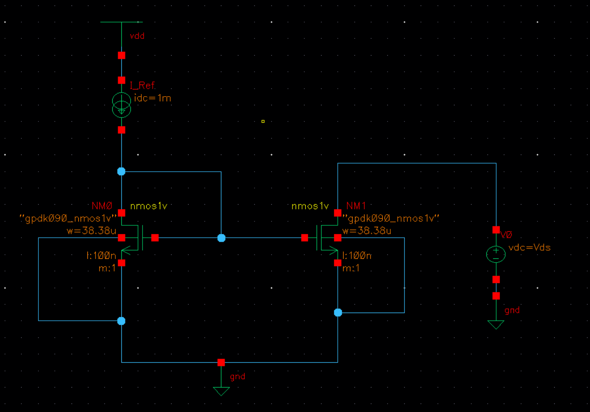
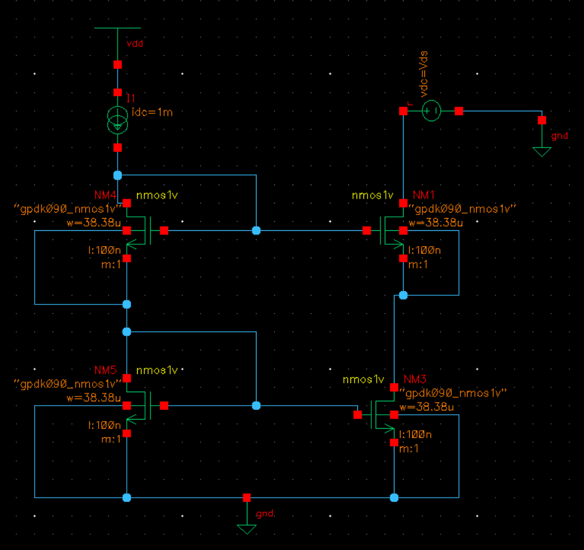
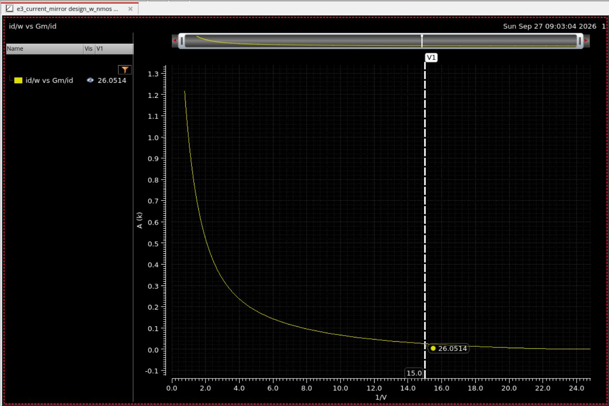
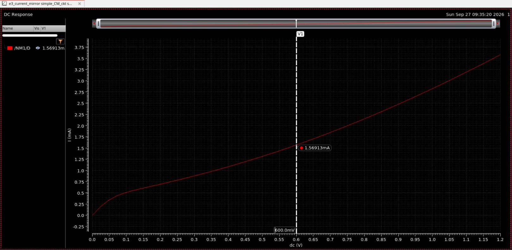
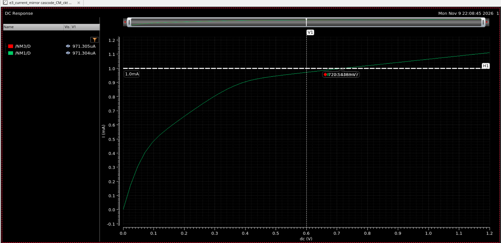

# Experiment 03 – Design of Simple and Cascode Current Mirror

[⬅ Back to all experiments](../README.md) · [📄 Full Report (PDF)](./Report.pdf)

**Tools:** Cadence Virtuoso (ADE L, Spectre), gpdk090 (90 nm CMOS, `nmos1v`)

## Contents
1. [Aim](#1-aim)
2. [Design Specifications](#2-design-specifications)
3. [Circuit Description](#3-circuit-description)
4. [Simulation Procedure](#4-simulation-procedure)
5. [Results](#5-results)
6. [Observations](#6-observations)
7. [Conclusion](#7-conclusion)
8. [Folder Structure](#8-folder-structure)

---

## 1. Aim
- To design and simulate **simple** and **cascode** current mirrors sized with the **gm/ID methodology** to produce an output current **Iout = 1 mA**.
- To study and compare their current-transfer characteristics (**ID vs VDS**).
- To determine the transistor sizes for a 2 mA output current.

## 2. Design Specifications
| Parameter | Value |
|---|---|
| Technology | gpdk090 (90 nm CMOS) |
| Device | `nmos1v` |
| gm/ID | 15 S/A |
| Output current | 1 mA (also sized for 2 mA) |
| Length | L = 100 nm |
| Reference current | I_Ref = 1 mA |
| Sweep | VDS: 0 to 1.2 V |

## 3. Circuit Description
**Simple current mirror:** two matched NMOS transistors (NM0, NM1) share the same gate voltage. NM0 is diode-connected and carries the reference current I_Ref, and NM1 delivers the mirrored output current.

**Cascode current mirror:** a second stacked pair is added (NM4/NM5 on the reference side, NM1/NM3 on the output side). The cascode device shields the mirror transistor from changes in the output voltage, which raises the output resistance.

| Circuit | Schematic |
|---|---|
| NMOS used for sizing | [View](./Schematic/01_nmos_sizing_schematic.png) |
| Simple mirror (W = 38.38 µm) |  |
| Cascode mirror (W = 38.38 µm) |  |

## 4. Simulation Procedure
1. Build a single NMOS test with variables `length`, `width`, `Vds`, `Vgs` and run a DC sweep. ([ADE setup](./Simulation/01_nmos_sizing_ade_setup.png))
2. In the calculator, divide **ID** by **W** and use `waveVsWave()` to plot **ID/W vs gm/ID**.
3. Read ID/W at **gm/ID = 15** from the plot.
4. Compute the width: `W = Iout / (ID/W)`.
5. Draw the simple and cascode mirrors with this W and a 1 mA reference source.
6. Sweep the output-side VDS from 0 to 1.2 V and plot the output current.
7. Compare the two ID vs VDS curves.

## 5. Results

### 5.1 Sizing (gm/ID = 15)


| Iout | gm/ID | ID/W | W | L |
|---|---|---|---|---|
| 1 mA | 15 | 26.05 µA/µm | **38.38 µm** | 100 nm |
| 2 mA | 15 | 26.05 µA/µm | 76.76 µm (or keep W and set I_REF = 2 mA) | 100 nm |

Design tables: [1 mA](./Simulation/02_design_calc_1mA.png) · [2 mA](./Simulation/03_design_calc_2mA.png)

### 5.2 Output characteristics
| Simple mirror: ID(NM1) vs VDS | Cascode mirror: ID(NM3) vs VDS |
|---|---|
|  |  |

### 5.3 Comparison
| Mirror | Output current at VDS = 0.6 V | Behaviour over the sweep |
|---|---|---|
| Simple | ≈ 1.57 mA | Keeps rising with VDS, to about 3.6 mA at 1.2 V |
| Cascode | ≈ 0.97 mA | Rises to about 1 mA (near VDS ≈ 0.72 V), then stays nearly flat |

## 6. Observations
- The simple mirror output current keeps increasing with VDS, because its output resistance is low (channel-length modulation). It moves well away from the 1 mA reference.
- The cascode mirror output flattens close to 1 mA and tracks the reference current much more closely, which means a higher output resistance.
- The cascode needs a larger minimum output voltage (compliance voltage) to keep all devices in saturation. This is visible as the slower rise at low VDS.
- The 2 mA design only needs a larger W (76.76 µm), or the same W with a 2 mA reference.

## 7. Conclusion
Simple and cascode current mirrors were designed with the gm/ID methodology (gm/ID = 15, W = 38.38 µm for 1 mA). The **cascode mirror is the better design** for accuracy: its output current stays close to 1 mA over the VDS sweep, while the simple mirror drifts well above it. The cost is a higher minimum output voltage. For 2 mA, the width scales to 76.76 µm.

## 8. Folder Structure
```
Experiment03_Current_Mirror
├── README.md
├── Schematic/
├── Simulation/
├── Waveforms/
└── Report.pdf
```

