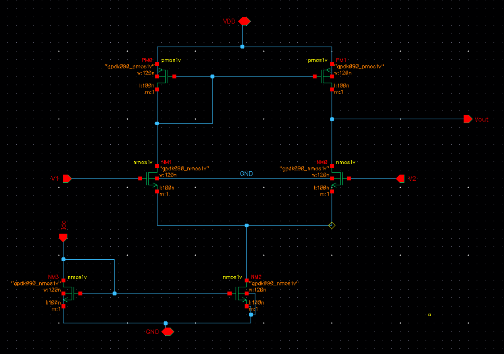
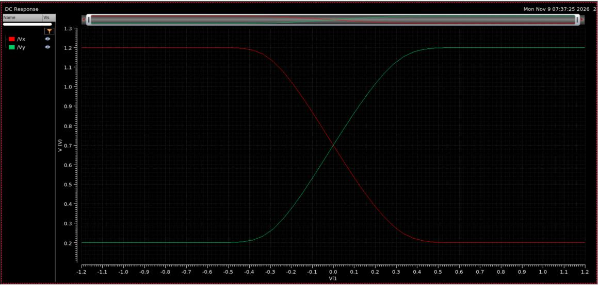
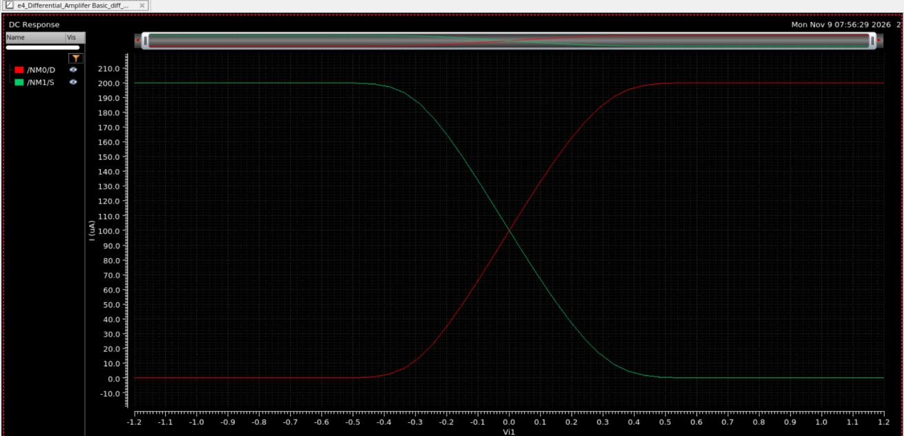
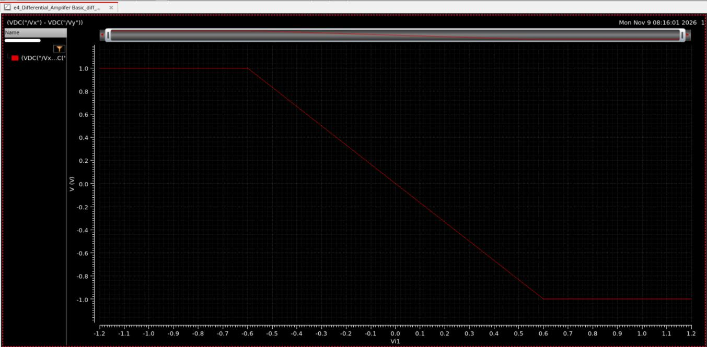
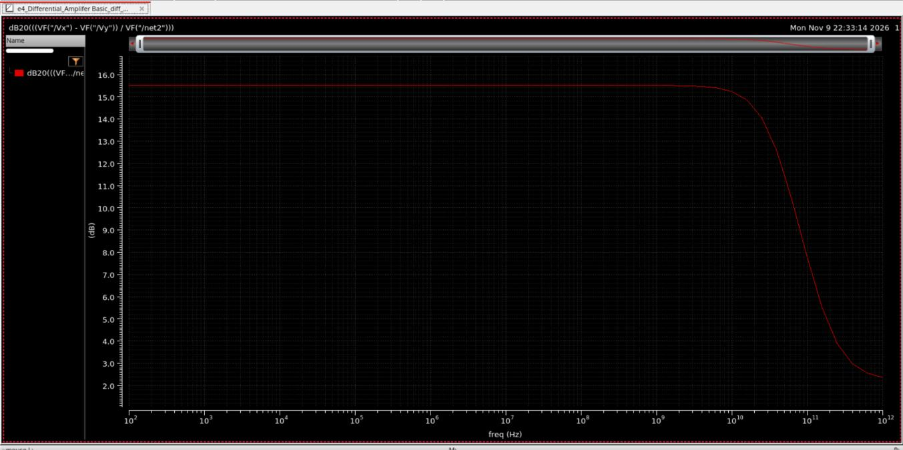
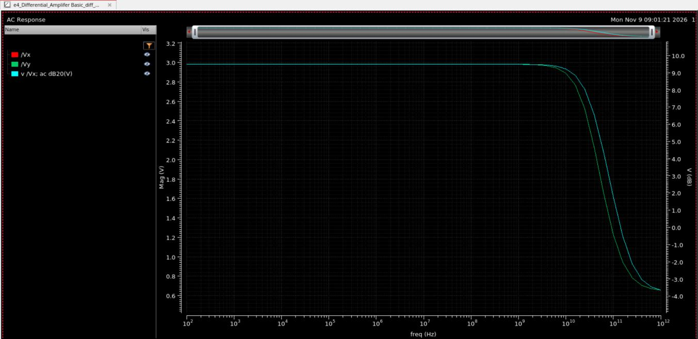
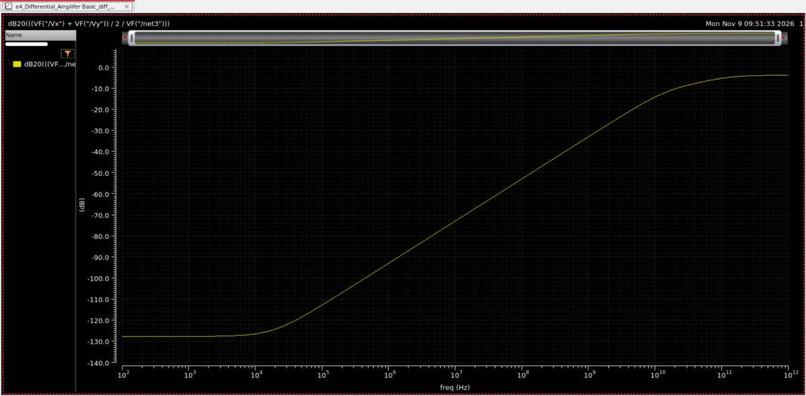
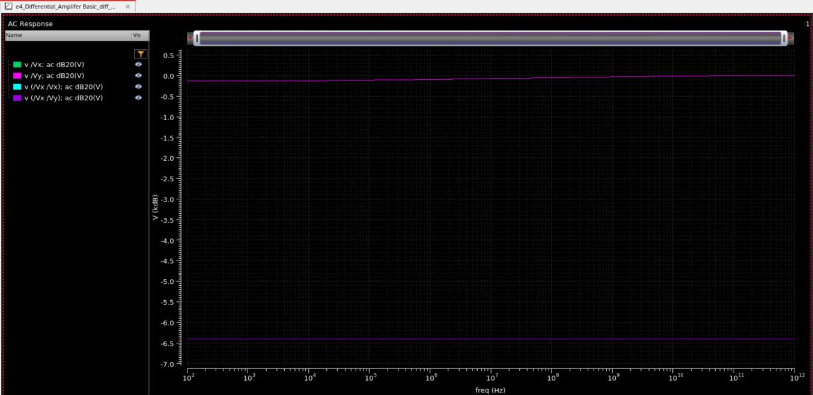
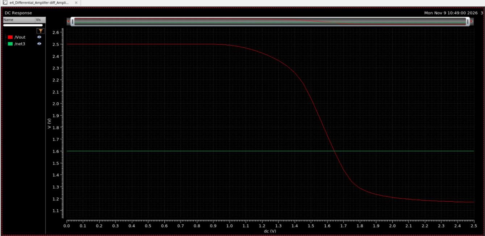
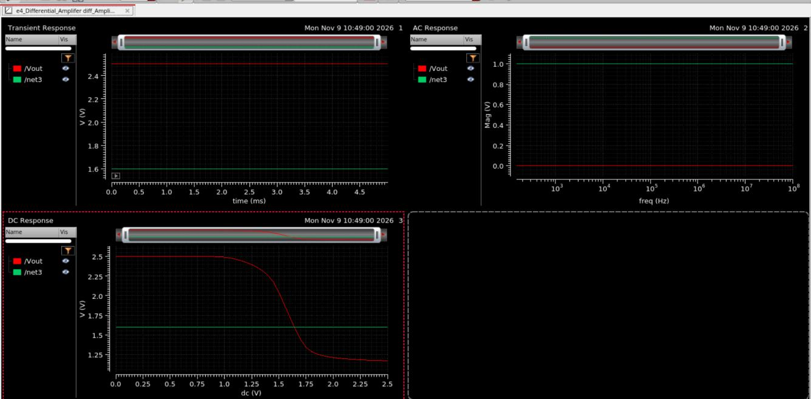

# Experiment 04 – Differential Amplifier

[⬅ Back to all experiments](../README.md) · [📄 Full Report (PDF)](./Report.pdf)

**Tools:** Cadence Virtuoso (ADE L, Spectre), gpdk090 (90 nm CMOS, `nmos1v`, `pmos1v`)

## Contents
1. [Aim](#1-aim)
2. [Design Specifications](#2-design-specifications)
3. [Circuit Description](#3-circuit-description)
4. [Simulation Procedure](#4-simulation-procedure)
5. [Results](#5-results)
6. [Observations](#6-observations)
7. [Conclusion](#7-conclusion)
8. [Folder Structure](#8-folder-structure)

---

## 1. Aim
- To design and simulate a **resistive-load differential amplifier** and study its **differential-mode** and **common-mode** gain.
- To perform **DC analysis** (current steering and output swing) and **AC analysis** (gain, bandwidth and CMRR).
- To design a **5-transistor OTA (5T-OTA)** with an active current-mirror load and simulate it (DC, AC, transient).

## 2. Design Specifications
| Circuit | Parameter | Value |
|---|---|---|
| Resistive-load differential amplifier | VDD | 1.2 V |
| | Tail current ISS | 200 µA |
| | RD | 5 kΩ |
| | W/L | 2 µm / 100 nm |
| | AC input | 1 V magnitude, DC 600 mV |
| | AC sweep | 100 Hz to 1000 GHz |
| 5T-OTA | VDD | 2.5 V |
| | Ibias | 30 µA |
| | W/L | 120 nm / 100 nm |

## 3. Circuit Description
**Resistive-load differential pair:** two NMOS transistors share a tail current source ISS. Each drain connects to VDD through RD, and the outputs are Vx and Vy, with Vo = Vx − Vy. The tail current always satisfies ISS = ID1 + ID2.

**5T-OTA:** the drain resistors are replaced by a **PMOS active current-mirror load** (PM0, PM1), with an **NMOS tail current mirror** (NM2, NM3). This converts the differential input into a single-ended output (Vout).

| Circuit | Schematic |
|---|---|
| DC analysis | [View](./Schematic/01_dc_analysis_schematic.png) |
| Differential mode | [View](./Schematic/02_diff_mode_schematic.png) |
| Common mode | [View](./Schematic/03_common_mode_schematic.png) |
| 5T-OTA |  |
| 5T-OTA symbol | [View](./Schematic/05_5T_OTA_symbol.png) |
| 5T-OTA testbench | [View](./Schematic/06_5T_OTA_testbench.png) |

## 4. Simulation Procedure
**A. DC analysis** (sweep Vi1 − Vi2 from −1.2 V to 1.2 V). Setups: [Vx, Vy](./Simulation/01_dc_ade_setup_vx_vy.png) · [ID1, ID2](./Simulation/02_dc_ade_setup_id1_id2.png) · [Vx − Vy](./Simulation/03_dc_ade_setup_vx_minus_vy.png) · [Parametric](./Simulation/04_dc_parametric_analysis.png)
1. Plot Vx, Vy vs (Vi1 − Vi2).
2. Plot ID1, ID2 vs (Vi1 − Vi2).
3. Plot (Vx − Vy) vs (Vi1 − Vi2).

**B. AC analysis (differential mode):** V1 and V2 have equal magnitude and a 180° phase difference ([V1](./Simulation/05_diff_mode_v1_properties.png), [V2](./Simulation/06_diff_mode_v2_properties.png)). Plot `dB20` of the differential gain and the single-ended gain. These can also be plotted with Direct Plot ([single-ended](./Simulation/07_direct_plot_form_single_ended.png), [differential](./Simulation/08_direct_plot_form_differential.png)).

**C. AC analysis (common mode):** apply the same input to both gates. Plot the common-mode gain Acm and the common-mode differential gain.

**D. 5T-OTA:** build the schematic, create the symbol, build the testbench, then run DC, AC and transient analyses. ([ADE setup](./Simulation/09_5T_OTA_ade_setup.png))

## 5. Results

### 5.1 DC analysis
| Vx, Vy vs (Vi1 − Vi2) | ID1, ID2 vs (Vi1 − Vi2) |
|---|---|
|  |  |



Theory notes:  [📄 Full Report (PDF)](./Report.pdf)


### 5.2 AC analysis, differential mode



### 5.3 AC analysis, common mode
| Common-mode gain Acm | Common-mode differential gain |
|---|---|
|  |  |

### 5.4 5T-OTA
| DC response | Transient, AC and DC |
|---|---|
|  |  |

### 5.5 Summary table
| Quantity | Result |
|---|---|
| Output common-mode level at Vi1 − Vi2 = 0 | Vx = Vy = 0.7 V (ID1 = ID2 = 100 µA) |
| Single-ended output range | 0.2 V to 1.2 V |
| Differential output saturation | ±ISS·RD = ±1.0 V |
| Mid-band differential gain Ad | ≈ 15.54 dB (5.98 V/V) |
| −3 dB bandwidth | ≈ 20 GHz |
| Single-ended gain (Vx or Vy) | ≈ 2.99 V/V (9.52 dB), half of Ad |
| Low-frequency common-mode gain Acm | ≈ −127.3 dB |
| CMRR (low frequency) | ≈ 142.8 dB |
| 5T-OTA DC transfer | Vout falls from 2.5 V to ≈ 1.18 V around V1 ≈ 1.5–1.6 V |

## 6. Observations
- At Vi1 − Vi2 = 0, the tail current splits equally (100 µA each), so Vx = Vy = VDD − (ISS/2)·RD = 0.7 V.
- Vx and Vy move in opposite directions between VDD = 1.2 V (transistor cut off) and VDD − ISS·RD = 0.2 V (full tail current in one branch).
- For large differential inputs (|Vi1 − Vi2| > 0.5 V), current steering is complete: one transistor carries all of ISS = 200 µA and the other carries 0 µA.
- The differential output saturates at ±ISS·RD = ±1.0 V, matching large-signal theory.
- Taking Vo = Vx − Vy cancels noise that appears equally on both nodes (common-mode noise).
- The single-ended gain is half the differential gain (−6 dB).
- The common-mode gain is very low (−127.3 dB) because the ideal tail current source has very high output impedance. This gives a high CMRR (≈ 142.8 dB).
- The circuit is symmetric, so Vx and Vy respond identically to Vcm and the common-mode differential gain is ideally zero.
- The 5T-OTA replaces the resistors with an active load. This gives higher gain (Av = gmn·(ron ∥ rop)), better voltage headroom and saves silicon area.

## 7. Conclusion
A resistive-load NMOS differential amplifier and a 5T-OTA were designed and simulated in Cadence Virtuoso using the gpdk090 process. The DC sweeps verified current steering (ID1 + ID2 = ISS = 200 µA) and the ±1.0 V output bounds. The AC analyses gave a mid-band differential gain of **15.54 dB** and a CMRR of about **142.8 dB**. The 5T-OTA with an active PMOS current-mirror load showed differential-to-single-ended conversion and a steep DC transition without passive resistors.

## 8. Folder Structure
```
Experiment04_Differential_Amplifier
├── README.md
├── Schematic/
├── Simulation/
├── Waveforms/
└── Report.pdf
```

